

  

  
  
  
  

Official repository for **"MFVSR: A Multi-Style and Fine-Grained Benchmark for Video Subtitle Removal"**.

# 🌠 Overview

**MFVSR** benchmarks the removal of burned-in video subtitles through three complementary dimensions: **Restoration Fidelity**, **Preservation Fidelity**, and **Temporal Fidelity**. It reports output coverage and failures alongside quality, so that a good result on available frames can be understood together with a method's ability to complete the task.

MFVSR provides:

- **3,000 paired videos** from three equally sized sources: Real-HQ, Real-LQ, and AI-Generated, with clean targets, glyph masks, and frame-level bounding boxes.
- **16 languages and 24 subtitle configurations**, combining spatial layout, temporal behavior, visual style, and monolingual/bilingual text.
- **Five spatial views and two evaluation tracks**: Lite3000 for broad evaluation and Audit300 for detailed structural and temporal analysis. Blind and mask-guided methods are reported separately.

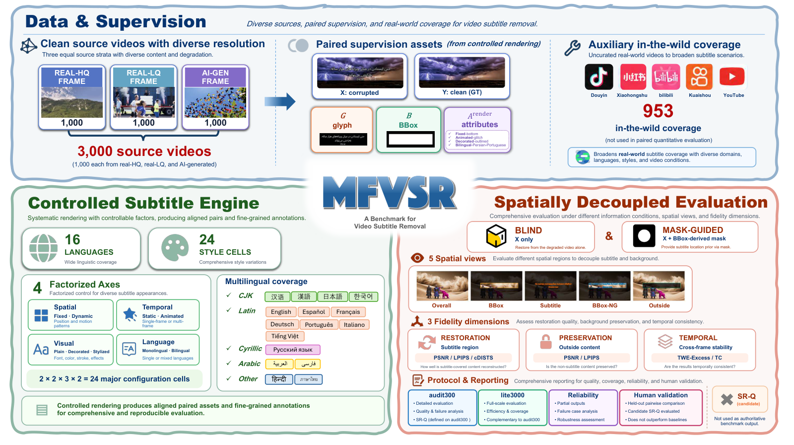

The figure summarizes the complete benchmark in the paper. This release focuses on the 3,000 paired samples; the paper's 953 auxiliary in-the-wild videos are a separate resource.

# 📊 Results

## 🖼️ Qualitative Comparisons

Diagnostic examples from Appendix E of the paper, with the subtitled input, clean target, and six methods shown side by side. CLEAR is blind; the other methods are mask-guided. Click any image to view its original resolution.

### 🧩 Restoration Fidelity · Shadowed bilingual subtitles

<i>Local crop · Frame 0 · Compare residual text and reconstructed scene texture with the clean target.</i>

<table>
  <tr>
    <td align="center" width="25%"><b>Subtitled input</b> <a href="./imgs/qualitative/restoration_input.png">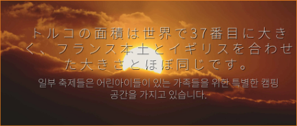</a></td>
    <td align="center" width="25%"><b>Clean target</b> </td>
    <td align="center" width="25%"><b>CLEAR (blind)</b> <a href="./imgs/qualitative/restoration_clear.png">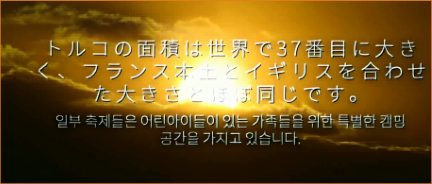</a></td>
    <td align="center" width="25%"><b>ProPainter</b> <a href="./imgs/qualitative/restoration_propainter.png">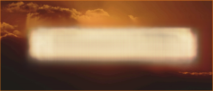</a></td>
  </tr>
  <tr>
    <td align="center" width="25%"><b>DiffuEraser</b> <a href="./imgs/qualitative/restoration_diffueraser.png">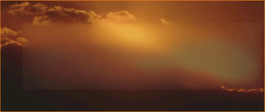</a></td>
    <td align="center" width="25%"><b>MiniMax-Remover</b> <a href="./imgs/qualitative/restoration_minimax.png">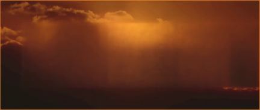</a></td>
    <td align="center" width="25%"><b>OmnimatteZero</b> <a href="./imgs/qualitative/restoration_omnimattezero.png">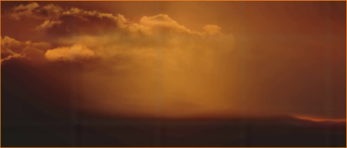</a></td>
    <td align="center" width="25%"><b>EffectErase</b> <a href="./imgs/qualitative/restoration_effecterase.png">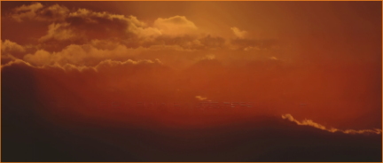</a></td>
  </tr>
</table>

### 🎨 Preservation Fidelity · Scene color and geometry

<i>Full frame · Frame 47 · Compare changes beyond the subtitle region.</i>

<table>
  <tr>
    <td align="center" width="25%"><b>Subtitled input</b> <a href="./imgs/qualitative/preservation_input.png">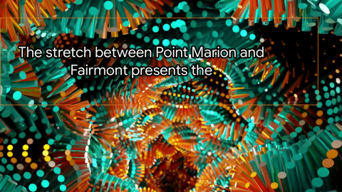</a></td>
    <td align="center" width="25%"><b>Clean target</b> <a href="./imgs/qualitative/preservation_target.png">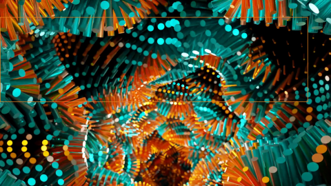</a></td>
    <td align="center" width="25%"><b>CLEAR (blind)</b> <a href="./imgs/qualitative/preservation_clear.png">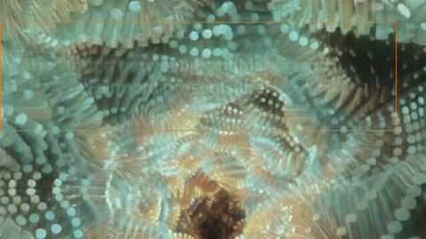</a></td>
    <td align="center" width="25%"><b>ProPainter</b> <a href="./imgs/qualitative/preservation_propainter.png">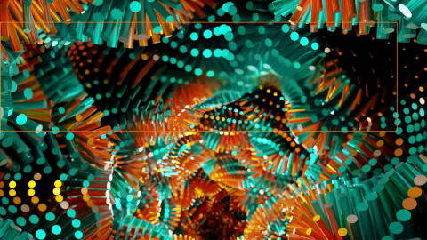</a></td>
  </tr>
  <tr>
    <td align="center" width="25%"><b>DiffuEraser</b> <a href="./imgs/qualitative/preservation_diffueraser.png">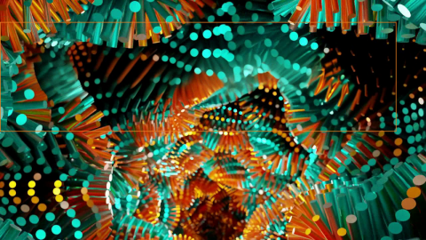</a></td>
    <td align="center" width="25%"><b>MiniMax-Remover</b> <a href="./imgs/qualitative/preservation_minimax.png">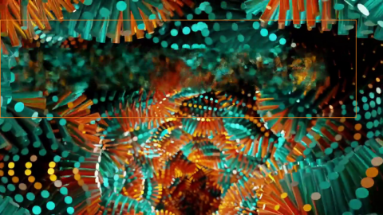</a></td>
    <td align="center" width="25%"><b>OmnimatteZero</b> <a href="./imgs/qualitative/preservation_omnimattezero.png">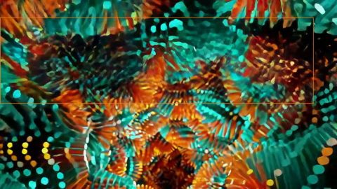</a></td>
    <td align="center" width="25%"><b>EffectErase</b> <a href="./imgs/qualitative/preservation_effecterase.png">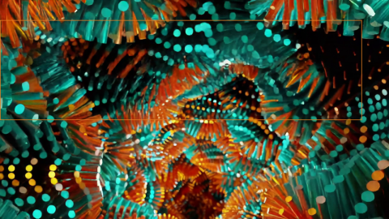</a></td>
  </tr>
</table>

### ⏱️ Temporal Fidelity · Bouncing neon · Three consecutive frames

Each strip shows frames 0 → 1 → 2 from the same shared crop. Compare both subtitle remnants and changes relative to the clean target.

<table>
  <tr>
    <td align="center" width="50%"><b>Subtitled input</b> <a href="./imgs/qualitative/temporal_input.png">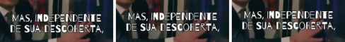</a></td>
    <td align="center" width="50%"><b>Clean target</b> <a href="./imgs/qualitative/temporal_target.png">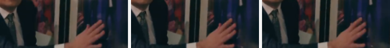</a></td>
  </tr>
  <tr>
    <td align="center" width="50%"><b>CLEAR (blind)</b> <a href="./imgs/qualitative/temporal_clear.png">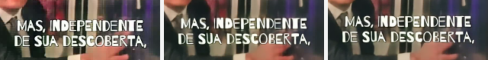</a></td>
    <td align="center" width="50%"><b>ProPainter</b> <a href="./imgs/qualitative/temporal_propainter.png">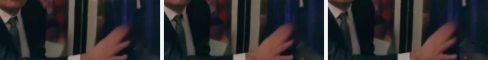</a></td>
  </tr>
  <tr>
    <td align="center" width="50%"><b>DiffuEraser</b> <a href="./imgs/qualitative/temporal_diffueraser.png">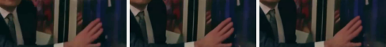</a></td>
    <td align="center" width="50%"><b>MiniMax-Remover</b> <a href="./imgs/qualitative/temporal_minimax.png">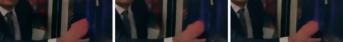</a></td>
  </tr>
  <tr>
    <td align="center" width="50%"><b>OmnimatteZero</b> <a href="./imgs/qualitative/temporal_omnimattezero.png">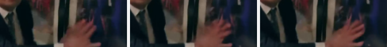</a></td>
    <td align="center" width="50%"><b>EffectErase</b> <a href="./imgs/qualitative/temporal_effecterase.png">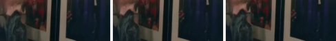</a></td>
  </tr>
</table>

[Case information and image provenance](./docs/qualitative_results.md)

## 📈 Quantitative Snapshot

**Audit300 · 300 fixed videos.** Subtitle LPIPS measures restoration and Outside LPIPS measures preservation; lower is better. Joint coverage describes how much aligned spatial/temporal output was evaluated. Bold marks the best mask-guided mean in each LPIPS column.

| Method | Setting | Subtitle LPIPS ↓ | Outside LPIPS ↓ | Joint cov. (%) ↑ |
| :--- | :--- | ---: | ---: | ---: |
| CLEAR | Blind | 0.621 | 0.221 | 85.4 |
| ProPainter | Mask-guided | 0.364 | **0.050** | 100.0 |
| DiffuEraser | Mask-guided | 0.269 | 0.062 | 99.9 |
| MiniMax-Remover | Mask-guided | 0.321 | 0.086 | 99.4 |
| OmnimatteZero | Mask-guided | 0.369 | 0.131 | 98.5 |
| EffectErase¹ | Mask-guided | **0.251** | 0.120 | 43.1 |

¹ EffectErase is evaluated on its verified prefix; consider its coverage alongside conditional quality.

[📊 Detailed tables](./docs/results.md#audit300-detailed-tables) · [📄 Lite3000 CSVs](./results/lite3000/) · [📄 Audit300 CSVs](./results/audit300/)

# 🚀 Running the Benchmark

Run the following commands from the repository root.

## 1. 🛠️ Set up the Conda environment

Create a Conda environment with Python 3.10, pip, setuptools, and ffmpeg/ffprobe. These shared dependencies are also recorded in [environment.yml](./environment.yml):

~~~bash
conda create -n mfvsr python=3.10 pip "setuptools>=68" ffmpeg \
  --override-channels -c conda-forge -y
conda activate mfvsr
~~~

Install the PyTorch build for your hardware. For **NVIDIA GPUs compatible with CUDA 12.4**, use:

~~~bash
python -m pip install torch==2.5.1 torchvision==0.20.1 \
  --index-url https://download.pytorch.org/whl/cu124

python -m pip install -e .
~~~

<b>AMD / ROCm, CPU, and macOS</b>

For **AMD GPUs**, install a PyTorch/torchvision build compatible with your GPU and ROCm version using the [official installation instructions](https://pytorch.org/get-started/locally/), then install the toolkit:

~~~bash
python -m pip install -e .
~~~

For **CPU-only Linux or Windows**:

~~~bash
python -m pip install torch==2.5.1 torchvision==0.20.1 \
  --index-url https://download.pytorch.org/whl/cpu
python -m pip install -e .
~~~

For **macOS**:

~~~bash
python -m pip install torch==2.5.1 torchvision==0.20.1
python -m pip install -e .
~~~

The PyTorch/torchvision version pair follows the [official version matrix](https://pytorch.org/get-started/previous-versions/). Other compatible builds can be used within the requirements declared in pyproject.toml.

Check the installation:

~~~bash
python -c "import torch, torchvision, mfvsr_eval; print('PyTorch:', torch.__version__); print('torchvision:', torchvision.__version__); print('GPU available:', torch.cuda.is_available())"
ffmpeg -version
ffprobe -version
~~~

The Python package is `mfvsr_eval`. Run all subsequent commands inside the `mfvsr` Conda environment.

When updating an existing preview installation, reinstall the package with `python -m pip install -e .` and use a fresh output directory for evaluation.

## 2. 🎬 Prepare the dataset

**Dataset download:** [Hugging Face](https://huggingface.co/datasets/siiian/MFVSR). See the dataset page for download and extraction commands.

Extract the paired dataset while preserving the paths in [benchmark_manifest.json](./manifests/benchmark_manifest.json):

~~~text
data/MFVSR/
├── data_select/       # Clean target videos
└── subtitled_data/    # Subtitled videos, glyph masks, BBox JSONs and input masks
~~~

[Dataset documentation](./docs/dataset.md) describes the assets and metadata. GitHub contains the manifests and fixed lists; large videos are distributed separately.

## 3. 📁 Prepare your predictions

Organize the outputs using the input video's directory relative to subtitled_data:

~~~text
predictions/your_method/
└── <input-relative-directory>/
    ├── info.json
    └── <video_id>_cleaned.mp4
~~~

For a successful prediction, the minimal info.json is:

~~~json
{
  "status": "success"
}
~~~

The directory placeholder includes the sample directory. For example, AI_gen/monolingual/Persian/<video_id> mirrors the corresponding input directory. See the [prediction interface](./docs/evaluation.md#prediction-interface) for other supported layouts and filenames.

Mask-guided methods use the BBox-derived input mask. Glyph masks and clean targets are reserved for evaluation.

Generate your local configuration:

~~~bash
python scripts/configure.py \
  --data-root data/MFVSR \
  --prediction-root predictions/your_method \
  --model your_method \
  --setting mask-guided \
  --geometry full_frame_resize_to_gt \
  --temporal verified_prefix
~~~

Use --setting blind for a blind method. The geometry option above assumes full-frame spatial correspondence; verified_prefix assumes correctly aligned prefix frames. Use --temporal exact for equal frame counts. The script creates configs/local.json and resolves the public manifest's paths without changing it.

## 4. 🧪 Run the benchmark

Lite3000 evaluates all 3,000 paired samples using PSNR, LPIPS, and Temporal Change Error (TC):

~~~bash
python -m mfvsr_eval.doctor \
  --config configs/local.json --profile lite3000

python -m mfvsr_eval.run \
  --config configs/local.json --model your_method --gpus 0 \
  --profile lite3000 --ids-file manifests/lite3000.txt
~~~

Use --gpus 0,1 for multiple GPUs or --gpus cpu for CPU execution.

## 5. 📊 Get the results

Aggregate the evaluation records into CSVs:

~~~bash
python -m mfvsr_eval.analyze \
  --config configs/local.json --model your_method \
  --profile lite3000 --ids-file manifests/lite3000.txt \
  --output-dir outputs/lite3000/analysis
~~~

Results are saved in outputs/lite3000/analysis/, including per-sample metrics, quality summaries, coverage, and reliability. Use the same profile and ID list for evaluation and analysis.

<b>🔬 Run Audit300 for detailed evaluation</b>

Audit300 uses the frozen 300-video subset and adds SSIM, conditioned DISTS, and RAFT-based TWE-Excess diagnostics.

~~~bash
python -m mfvsr_eval.doctor \
  --config configs/local.json --profile audit300 --deep --device cuda:0

python -m mfvsr_eval.run \
  --config configs/local.json --model your_method --gpus 0 \
  --profile audit300 --ids-file manifests/audit300.txt

python -m mfvsr_eval.analyze \
  --config configs/local.json --model your_method \
  --profile audit300 --ids-file manifests/audit300.txt \
  --output-dir outputs/audit300/analysis
~~~

Pretrained metric weights may download on first use. See the [evaluation guide](./docs/evaluation.md) and [protocol](./docs/protocol.md) for alignment, metric settings, and fixed lists.

# ⭐ Citation

The paper link and BibTeX entry will be added when the manuscript is publicly available.

<!-- Add the verified public paper URL and author BibTeX here. -->

# ⚖️ License

Code and dataset license information will be added with the public release.
